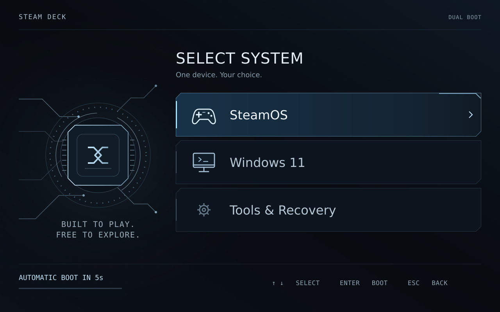

# Ice Circuit for Steam Deck

Steam Deck の電源を入れたときに、SteamOS と Windows を選べる回路デザインの起動メニュー。黒とアイスブルーの画面に、よく使う2つの OS を大きく表示します。

*デザインプレビューです。実際の画面とは文字や余白が多少異なります。*

**0.1.0-alpha.6 は開発中の検証版です。** 実機確認済みの環境は Steam Deck LCD・SteamOS 3.8.16・Windows 10。[確認できたことと未検証の範囲](docs/VALIDATION.md)を公開しています。

## ダウンロードして使う

**[GitHub Releases を開く](https://github.com/cobo920/steamdeck-ice-circuit/releases/tag/v0.1.0-alpha.6)** → **Assets** にある **`Ice-Circuit-SteamDeck-0.1.0-alpha.6.zip`** を選んでください。`Source code` は通常の導入用ではありません。

1. Steam Deck をデスクトップモードにして、ZIP をダウンロードします。
2. ファイル管理アプリ **Dolphin** で ZIP を展開します。
3. 展開したフォルダー内の **`Install Ice Circuit.desktop`**（表示名：**Ice Circuit セットアップ**）を開きます。
4. OS の表示名・待ち時間などを選び、プレビューを確認して適用します。
5. 完了後、ご自身のタイミングで再起動して確認します。

**[初めての方はこちら：画面に沿った導入手順](docs/GETTING-STARTED.md)** · [困ったとき・元に戻す](docs/RECOVERY.md)

通常の導入は画面操作で進められます。管理者認証には **Steam Deck 本体のローカルパスワード** が必要です。まだ設定していない場合だけ、[最初のパスワード設定](docs/GETTING-STARTED.md#password)を行います。展開したフォルダーは設定変更や削除にも使うため、まとめて保管してください。

## 使える環境とできること

- SteamOS と Windows がすでに入っていて、SteamOS を起動できる Steam Deck が対象です。
- SteamOS 標準の起動設定を使います。rEFInd・Clover など別の起動管理ツールが見つかった場合は停止します。
- Windows の表示名、何秒待つか、自動で選ぶ OS、任意のアイコンを設定できます。詳細な起動・復旧項目は **Tools & Recovery** から選べます。
- 変更前の設定をバックアップし、ツールから修復・取り外し・復元ができます。

Windows のインストールやディスク分割は行いません。**電源を入れたときの起動先登録が失われている場合は、テーマ設定とは別の復旧が必要です。** 本ツールはその登録・起動順を変更しません。

## アイコンについて

標準では、このプロジェクトで描いたゲームパッドとモニターを使います。利用できる画像が手元にあれば、設定画面から差し替えられます。

[各社のロゴ・利用条件を確認](docs/LOGOS.md) — 各社の公式案内へのリンクです。公式ロゴの同梱・自動取得は行いません。

## 開発・ライセンス

コードやテストに関心がある方は[開発者向けガイド](docs/DEVELOPMENT.md)をご覧ください。

コード・独自アートは **GPL-3.0-or-later**、フォントは同梱の独自条件に従います。[LICENSE](LICENSE) · [NOTICE](NOTICE) · [フォント条件](licenses/DejaVu-Fonts-LICENSE.txt)

Ice Circuit は Valve および Microsoft と提携関係のない独立したプロジェクトです。Steam、SteamOS、Steam Deck は Valve Corporation の商標です。Microsoft および Windows は Microsoft グループの企業の商標です。
