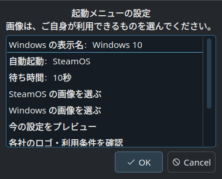

# はじめての Ice Circuit

Steam Deck の画面を操作して、起動メニューを設定する手順です。通常の導入に Git・SSH・コマンド入力は必要ありません。Deck 本体のパスワードが未設定の場合だけ、末尾の[パスワード設定](#password)を先に行ってください。

対象は **SteamOS と Windows をすでに使える Steam Deck** です。Ice Circuit は Windows をインストールするツールではありません。現在の実機確認は LCD 版・SteamOS 3.8.16・Windows 10 で行っています。[検証記録](VALIDATION.md)

## 1. デスクトップモードにする

SteamOS の **STEAM ボタン → 電源 → デスクトップに切り替え** を選びます。Steam を起動したままなら、**STEAM＋X** で画面キーボードを開けます。操作しづらい場合はキーボードやマウスを接続しても構いません。[Valve のデスクトップ案内](https://help.steampowered.com/en/faqs/view/671A-4453-E8D2-323C)

## 2. 導入用の ZIP をダウンロードする

Deck のブラウザーで [Ice Circuit のリリースページ](https://github.com/cobo920/steamdeck-ice-circuit/releases/tag/v0.1.0-alpha.6)を開きます。

**Pre-release** と表示された `v0.1.0-alpha.6` の **Assets** を開き、次のファイルを選んでください。

**`Ice-Circuit-SteamDeck-0.1.0-alpha.6.zip`**

`Source code (zip)` / `Source code (tar.gz)` や、リポジトリの `Code → Download ZIP` は選びません。リリース一覧から探す場合も、上記の名前を確認してください。

ブラウザーがまだ使えない場合は、デスクトップの **Discover** で Chrome または Firefox などをインストールします。[Valve のアプリ導入案内](https://help.steampowered.com/en/faqs/view/671A-4453-E8D2-323C)

## 3. ZIP を展開する

ファイル管理アプリ **Dolphin** を開き、左側の **ダウンロード / Downloads** に進みます。保存した ZIP を右クリックし、**展開 / Extract → ここに展開 / Extract here** を選んでください。ZIP を開いて Ark が表示された場合は、上の **展開 / Extract** ボタンから全ファイルを展開できます。[KDE の展開操作](https://docs.kde.org/stable_kf6/en/ark/ark/ark-in_filemanager.html)

ZIP の中を眺めている状態ではなく、**展開後のフォルダー** を開いてください。フォルダー内に `Install Ice Circuit.desktop` と `assets`、`src` などが揃っていれば準備完了です。

## 4. セットアップを開く

展開したフォルダー内の **`Install Ice Circuit.desktop`** を開きます。Dolphin では **Ice Circuit セットアップ** または **Ice Circuit Setup** と表示されることがあります。

KDE が実行の確認を表示した場合は、ダウンロードした Ice Circuit のランチャーであることを確認して **実行** を選びます。ランチャーだけを別の場所へ移さず、フォルダー全体を保管してください。

## 5. 表示と待ち時間を選ぶ

最初の画面で **インストール・設定変更** を選びます。

*検証機の設定画面です。この例は Windows 10・SteamOS の自動起動・10秒に設定済みです。初めて導入する場合は Windows・SteamOS・5秒から選び直せます。下に隠れた項目は、一覧をスクロールすると表示されます。*

| 設定 | 選ぶ内容 |
| --- | --- |
| Windows の表示名 | `Windows` / `Windows 10` / `Windows 11`。実際に入っている OS に合わせて選びます。 |
| 自動起動 | メニューで操作しなかったときに起動する OS。 |
| 待ち時間 | 1〜60秒。初回の既定値は5秒です。 |
| SteamOS / Windows の画像 | 最初は標準アイコンのままで進められます。手元の利用できる画像に差し替えることもできます。 |

すでに Ice Circuit を使っている場合は、保存済みの表示名・待ち時間・自動起動先を読み込みます。画像を変更しなければ、現在の画像を保持します。

## 6. プレビューを確認する

**今の設定をプレビュー** を選ぶと、ブラウザーの別画面に表示されます。セットアップ画面が手前にある場合は、画面下のタスクバーからブラウザーに切り替えてください。確認が終わったらセットアップへ戻ります。

実際の起動画面とは文字や余白が多少異なります。また、更新時に変更していない既存のカスタム画像は、プレビューでは標準画像で表示されます。適用時には既存画像を保持します。

## 7. 認証して適用する

一覧を下にスクロールして **変更内容を確認して適用** を選びます。認証画面には **Deck 本体のローカルパスワード** を入力してください。Steam アカウントのパスワードや Windows の PIN ではありません。最近の認証が有効な場合は、入力が省略されることがあります。

続いて表示名・自動起動先・待ち時間・画像の変更内容を確認し、**適用する** を選びます。**戻る** を選べば、その変更は適用されません。

「**本体が SteamOS を自動で起動する設定が見つかりません。**」と表示された場合は、いったん **戻る** を選んで[起動経路の確認](RECOVERY.md#boot-menu)へ進んでください。テーマを適用しても、この起動登録は修復されません。

適用中は完了表示まで待ちます。変更前の設定は自動でバックアップされ、完了画面にバックアップの識別情報が表示されます。

## 8. 自分のタイミングで再起動する

完了画面を閉じ、セットアップを終了します。作業を保存してから通常の操作で再起動し、メニューと SteamOS の起動を確認してください。その後、Windows も選べることを確認します。

変更後に困った場合は、[修復・取り外し・バックアップから戻す](RECOVERY.md)を参照してください。

## よくある質問

### Deck 本体のパスワードをまだ設定していない

Valve は、初期状態のローカルユーザーにはパスワードがなく、管理者操作のために端末の `passwd` で設定する方法を案内しています。ここだけは、一度だけ短いコマンドを入力します。[Valve の公式説明](https://help.steampowered.com/en/faqs/view/671A-4453-E8D2-323C)

1. セットアップを閉じ、デスクトップ左下のアプリ一覧で **Konsole** を検索して開きます。
2. `passwd` と入力して Enter を押します。
3. 新しいパスワードを入力して Enter、確認のため同じものをもう一度入力して Enter を押します。入力中に文字や `*` が出ないのは正常です。
4. 更新成功の表示を確認して Konsole を閉じ、セットアップを開き直します。

これは Deck 本体のパスワード設定です。Steam や Windows のパスワードを変更するものではありません。現在のパスワードを求められた場合は、すでに設定されています。覚えていない場合は繰り返し推測せず、認証を中止してください。パスワードを問い合わせやスクリーンショットに含めないでください。

### ランチャーを開いても設定画面が出ない

まず、ZIP の表示画面ではなく **展開後のフォルダー** から開いていることを確認します。`assets` や `src` がなく、ランチャーだけになっている場合は ZIP を展開し直してください。

「実行できない」という表示が出た場合は、ランチャーを右クリックして **プロパティ → アクセス許可 / Permissions** を開き、実行を許可する項目を確認してください。項目名は KDE の言語・バージョンで異なります。ほかのファイルのアクセス許可を変更する必要はありません。

### プレビューが見つからない／ブラウザーがないと言われる

プレビューは別のブラウザー画面です。画面下のタスクバーで Chrome などを確認してください。アプリは使用できる既定ブラウザーを優先し、未導入ブラウザーの案内を指している場合は、導入済みの Chrome・Firefox・Chromium を探します。既定ブラウザーの設定自体は変更しません。

ブラウザーがなければ Discover で導入して、もう一度プレビューを開きます。

### 画像を選べない

PNG・JPEG・SVG に対応しています。PNG は非インターレース・8-bit 以下、SVG は外部画像などを参照しない静的な図形が対象です。複雑な SVG は画像編集アプリで PNG に保存してから選んでください。選んだ画像は縦横比を保った小さなアイコンに変換されます。

### 更新したい

[Releases](https://github.com/cobo920/steamdeck-ice-circuit/releases)から新しい導入用 ZIP を入手し、以前のフォルダーとは別の場所へ展開します。そのランチャーで **インストール・設定変更** を開き、保存済みの設定を確認して適用してください。既存の画像を保持したい場合は画像の選択・リセットを行いません。

[README に戻る](../README.md) · [困ったとき・元に戻す](RECOVERY.md)
